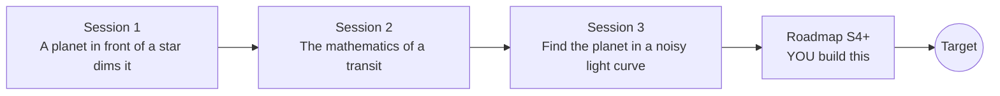

# openexoplanet

[](https://github.com/KrunalPanchal1995/openexoplanet/actions/workflows/ci.yml)   [](https://colab.research.google.com/github/KrunalPanchal1995/openexoplanet/blob/main/sessions/session-01/lesson.ipynb) [](https://krunalpanchal1995.github.io/openexoplanet/)

**Find a planet around another star from a tiny dip in its starlight, in three sessions.**

openexoplanet teaches how astronomers find planets around other stars by watching starlight dip, from a flat box to a Box Least Squares search, using only Python and a browser.

- **Start from zero.** Session 1 needs only school-level ratios and areas; every symbol is explained.
- **See it move.** Every session ships a slider app that runs in the browser, with labelled graphs.
- **Know you got it right.** Each session ends with a checkpoint that prints PASS or FAIL against hand calculations.
- **Build the missing half.** The repo stops at Session 3 on purpose; the roadmap shows the path to the Target.

[Target](#the-target) · [Who is this for](#who-is-this-for) · [Quick start](#quick-start) · [Sessions](#sessions) · [Roadmap](#roadmap) · [Contribute](#contribute) · [Explainer PDF](docs/explainer.pdf)

> **This repo is incomplete on purpose.** Sessions 1 to 3 are here and fully working. The finished Target below is a preview of what the community can build next. We show you the path, not the code. Sessions 4 and up are yours.

## The Target

A star with spots rotating in and out of view hides a planet whose dip is only about 0.1 percent deep, much smaller than the dips in the lessons. Watch the light curve being drawn, the Box Least Squares periodogram sharpen into a single peak at 5.37 days as transits accumulate, and the transits stack up in a phase-folded plot with a limb-darkened model fit that recovers the planet size. Your goal over the coming sessions: build the missing pieces (a detrend that cannot eat the transit, a limb-darkened fit, stronger vetting) and reproduce that result yourself.


*Target: finding a small planet in a spotted star's light curve (light curve, BLS periodogram, folded fit)*


*Target, final frame: P = 5.37 d, recovered radius ratio and fit*

Try it live:

- [Math Visual Studio (open the Studio and explore)](https://krunalpanchal1995.github.io/studio/)

How the Target was made is shown only as a path in [promo/roadmap.md](promo/roadmap.md).

## Who is this for
**secondary school to diploma / undergraduate (levels 3-5).** Topic area: Astronomy and Space Science.

Prerequisites:

- Area of a circle and the idea of a ratio (school mathematics).
- Python 3.10 or newer; if `python --version` works, you are ready. PRIMER.md explains the rest.
- No prior astronomy, GitHub or statistics experience is needed.

New to Python? Read [PRIMER.md](PRIMER.md) first (10 minutes).

## Quick start

No installation knowledge needed. You need [Git](https://git-scm.com/downloads) and [Python 3.10+](https://www.python.org/downloads/) (Windows: tick "Add Python to PATH"). On Mac and Linux type `python3` wherever this page says `python`.

```bash
git clone https://github.com/KrunalPanchal1995/openexoplanet.git
cd openexoplanet
python start.py 1
```

`start.py` creates a private environment, installs what is needed and runs Session 1 with its checkpoint. Next: `python start.py 2`, `python start.py 3`, or `python start.py test` to check everything. Only a checkpoint: `python start.py check 1`.

A few lines turn the idea of Session 1 into a result (they work as they are): Save it as `try.py` and run it with `python start.py run try.py` (this uses the private environment, where NumPy is installed):

```python
import numpy as np
k = 6371 / 695700                       # Earth radius / Sun radius
print(round(k ** 2 * 1e6, 1), 'ppm')     # -> 83.9 ppm: how much light Earth blocks
k = 71492 / 695700                      # Jupiter radius / Sun radius
print(round(k ** 2 * 100, 2), 'percent') # -> 1.06 percent
```

Every session also opens in your browser with sliders (no install): [live apps](https://krunalpanchal1995.github.io/openexoplanet/). Or use the Colab badge above for the notebook.

## Sessions

| # | Session | Model level | Time | Live app |
|---|---|---|---|---|
| 1 | [A planet in front of a star dims it](sessions/session-01/README.md) | Level 1: conceptual interactive model | 60 min | [open](https://krunalpanchal1995.github.io/openexoplanet/session-01/) |
| 2 | [The mathematics of a transit](sessions/session-02/README.md) | Level 2: mathematical engineering model | 75 min | [open](https://krunalpanchal1995.github.io/openexoplanet/session-02/) |
| 3 | [Find the planet in a noisy light curve](sessions/session-03/README.md) | Level 3: simulation and validation | 90 min | [open](https://krunalpanchal1995.github.io/openexoplanet/session-03/) |

Each session follows the same six steps: A real-world problem, B concept and theory, C visual explanation, D interactive simulation, E worked example and experiment, F assessment and design challenge. Each ends with `checkpoint.py`, which prints `PASS` or `FAIL` against reference numbers. Session 3 also contains the real-world mini-project: **Find the planets in a provided light curve**.

## Architecture



| Folder or file | What is inside |
|---|---|
| `sessions/` | three sessions: README (A-F), `lesson.py`, notebook, live app, exercises, activity sheet, checkpoint |
| `promo/` | the Target: media, live links, and the roadmap (path only) |
| `docs/` | `explainer.tex` and the built `explainer.pdf` |
| `tests/` | runs every lesson and checkpoint headless |
| `start.py` | one command to set up and run anything |
| `QUALITY.md`, `RUBRIC.md` | the quality checklist and the scoring rubric |
| `.github/` | CI, PDF build, Pages deploy, issue and PR templates |

## Roadmap

| Milestone | What you will build | Difficulty |
|---|---|---|
| Session 4: A detrend that cannot eat the transit | A detrending routine that finds a candidate, masks its transits and refits the trend. | intermediate |
| Session 5: Fit the transit with limb darkening | A fitting function that returns the radius ratio and impact parameter with uncertainties. | intermediate |
| Session 6: A weaker planet | A search that detects a 600 ppm planet (period 4.2 days) at the same noise as the demo. | advanced |
| Session 7: Unmask the binary | A vetting function that tests the folded curve at phase 0.5 and at twice the BLS period. | advanced |
| Session 8: Real data | The full pipeline run on a downloaded real light curve of a known planet. | advanced |

Full detail with a checkpoint per milestone: [promo/roadmap.md](promo/roadmap.md).

## Contribute
New to GitHub? Read [CONTRIBUTING.md](CONTRIBUTING.md); it starts from zero. Pick an issue labelled `good first issue`. Translations into Hindi, Telugu, Tamil and Malayalam are welcome.

<details>
<summary>Development</summary>

```bash
python start.py test        # runs every lesson and checkpoint
```
Lessons use `# %%` cell markers so they open as notebooks in VS Code. See [QUALITY.md](QUALITY.md) for the standard every session meets.
</details>

## License
MIT. See [LICENSE](LICENSE). Media in `promo/media` is (c) Krunal Panchal, CC BY 4.0.

## Acknowledgments
Part of the [PAN IIT OSS](https://hellofoss.tech-iitb.org/projects) open-source teaching collection, modelled on the structure of [openspline](https://github.com/openspline/openspline). Built on ideas from the Math Visual Studio at https://krunalpanchal1995.github.io/studio/.
