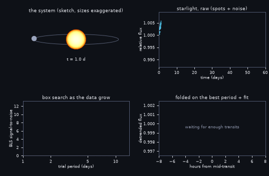
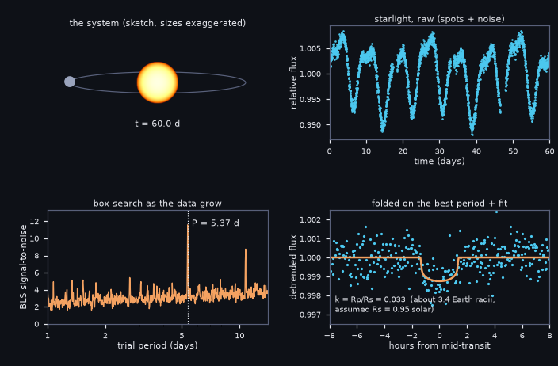

# What you are building toward

A star with spots rotating in and out of view hides a planet whose dip is only about 0.1 percent deep, much smaller than the dips in the lessons. Watch the light curve being drawn, the Box Least Squares periodogram sharpen into a single peak at 5.37 days as transits accumulate, and the transits stack up in a phase-folded plot with a limb-darkened model fit that recovers the planet size. Your goal over the coming sessions: build the missing pieces (a detrend that cannot eat the transit, a limb-darkened fit, stronger vetting) and reproduce that result yourself.

*Target: finding a small planet in a spotted star's light curve (light curve, BLS periodogram, folded fit)*

*Target, final frame: P = 5.37 d, recovered radius ratio and fit*

These results come from a private reference build. The code is not published; the roadmap shows the path so you can build your own.

Live links:

- [Math Visual Studio (open the Studio and explore)](https://krunalpanchal1995.github.io/studio/)
