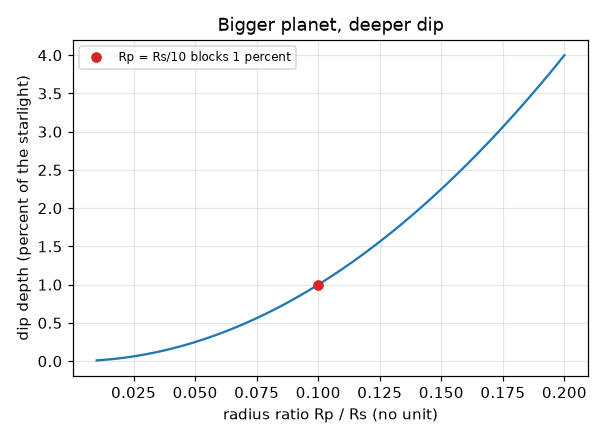
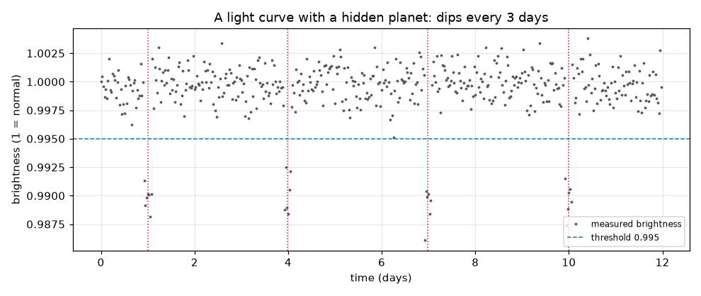

# Session 1: A planet in front of a star dims it

*Level 1 (conceptual interactive model) · about 60 minutes · openexoplanet*

> This is a simplified educational model. It is not a validated design tool and must not be used for real structures, electrical installations, vehicles, industrial processes or medical decisions.

**Prerequisites**

- Area of a circle, and what a ratio is.
- You have read PRIMER.md and run `python start.py 1` once.

**Learning objectives.** After this session you can:

- Explain why a planet crossing its star makes the starlight dip.
- Compute how deep the dip is from the planet-to-star radius ratio.
- Find dips in a noisy brightness record and read the orbital period from their spacing.
- Read a light curve: brightness against time.

## A. Real-world problem
Stars are so far away that even the best telescopes see them as single points of light, and a planet next to a star is lost in its glare. But if the planet's orbit is seen edge-on, the planet passes in front of its star once per orbit and blocks a little of the light. A telescope that measures the star's brightness again and again sees a tiny, regular dip. How deep is the dip, how often does it repeat, and how do you tell it from random noise?

## B. Concept and theory
A light curve is a graph of a star's brightness (1 = normal) against time. A transit is a dip that happens when a planet's dark disk covers part of the star's bright disk. The fraction of light blocked equals the fraction of the star's disk that is covered, which is the ratio of the two disk areas: (pi Rp^2) / (pi Rs^2) = (Rp/Rs)^2. The planet comes back once every orbit, so the gap between the centres of neighbouring dips is the orbital period P. Real measurements are noisy, so a point only counts as part of a dip if it lies below a threshold, and we require a few low points in a row.

| Symbol | Meaning | Unit |
|---|---|---|
| Rp | planet radius | km (any length unit) |
| Rs | star radius | same unit as Rp |
| k = Rp/Rs | radius ratio | no unit |
| depth | fraction of starlight blocked | no unit (0.01 = 1 percent) |
| P | orbital period = time between dips | days |
| t | time | days |

**Assumptions**

- The planet's orbit is seen exactly edge-on, so it crosses the middle of the star.
- The star is evenly bright (a flat disk); Session 2 removes this.
- The dip is a flat-bottomed box with instant edges (a simplification).
- Noise is random and the same for every measurement.

$$ \text{depth}=\frac{\pi R_p^2}{\pi R_s^2}=\left(\frac{R_p}{R_s}\right)^2=k^2 $$

$$ t_n=t_0+nP\qquad\Rightarrow\qquad P=t_{n+1}-t_n $$

## C. Visual explanation
The first figure is a synthetic light curve: 480 measurements over 12 days with four dips marked by dotted lines at days 1, 4, 7 and 10, which are 3 days apart. The dashed line is the threshold. The second figure plots depth against the radius ratio k: a curve that bends upward, because depth goes as k squared. The red dot marks k = 0.1, a planet with a tenth of the star's radius, which blocks 1 percent of the light.

*Depth against radius ratio: a planet with a tenth of the star's radius blocks 1 percent.*

*A synthetic light curve: four dips three days apart, found below the dashed threshold.*

## D. Interactive simulation
Run the lesson (`python start.py 1`), then open the live app: [Session 1: watch a star blink](https://krunalpanchal1995.github.io/openexoplanet/session-01/) (or `app.html` in this folder). Move the time slider and watch the planet cross the star in the picture while a red dot follows the brightness on the graph. Then change the planet size and the period.

**Challenge.** Make the dips 1 percent deep and repeat every 4 days.

## E. Worked example and experiment
**Problem.** A star dips by 0.0025 (0.25 percent) with dip centres at days 2, 7 and 12. Find the orbital period and the planet-to-star radius ratio.

1. Gaps between dip centres: 7 - 2 = 5 days and 12 - 7 = 5 days, so P = 5 days.
2. depth = k^2 = 0.0025, so k = sqrt(0.0025) = 0.05.
3. Check: a planet with 5 percent of the star's radius covers 0.05 x 0.05 = 0.0025 of its disk.

**Answer.** Period 5 days; radius ratio Rp/Rs = 0.05.

**Experiment.** Hold a coin (the planet) a few centimetres in front of a small lamp bulb (the star) that is a metre away from a phone camera set to a fixed exposure, and slide the coin across it; compare the drop in the picture's brightness with the covered fraction of the bulb. Expect a rough match only: a real bulb is not a flat disk, the coin is not at the star, and the camera has its own noise. The model is exact for flat disks; real stars and cameras are not flat or noiseless.

## F. Assessment and design challenge
**Question type A: Conceptual.** Why does a transit only happen for some planets? Why do astronomers need to watch a star for longer than one orbit to be sure about a planet?

Hint

Think about the orbit's tilt, and about what one dip alone can and cannot tell you.

Step-by-step solution

A transit needs the orbit to be seen almost edge-on; for most orbits the planet passes above or below the star and nothing dips. One dip could be a glitch, a flare, a spot or noise; two or more dips with the same depth and equal spacing give a period and strong evidence that a planet repeats its pass.

**Question type B: Numerical.** A planet has half the radius of its star. What fraction of the light does it block? Is that realistic for a planet?

Hint

depth = k^2 with k = 0.5.

Step-by-step solution

depth = 0.5^2 = 0.25, so 25 percent of the light. That is far larger than any real planet around a Sun-like star: even Jupiter blocks only about 1 percent. A dip that deep would more likely be a second star (a binary).

**Question type C: Graph and simulation interpretation.** In the slider app the graph shows dips with period 3 days. You raise the period to 6 days but keep the planet size. What changes on the graph, and what stays the same?

Hint

Compare the depth and the spacing of the dips.

Step-by-step solution

The dips become twice as far apart (6 days) and fewer fit in 12 days (two instead of four); their depth does not change because the planet size did not change. Depth depends on k only; spacing depends on P only.

**Question type D: Design and optimisation challenge.** Design: you can watch a star for 12 days. A planet has a period of 5 days. What is the smallest number of dips you will see, and what is the longest period for which you are guaranteed to see two dips?

Hint

Dips are spaced P apart. Slide the first dip anywhere in the first P days.

Step-by-step solution

With P = 5 days in 12 days you see at least 2 dips (and up to 3, depending on where the first falls). To be sure of two dips, the 12-day run must contain two dips wherever the first falls: the first dip can occur as late as day P, and the second at day 2P, so we need 2P <= 12, i.e. P <= 6 days. Longer periods may show only one dip. Trade-off: watching longer finds longer periods.

Score yourself with [RUBRIC.md](../../RUBRIC.md). Print the [activity sheet](activity_sheet.md) to work on paper.

## Common misconceptions
| Common misconception | What is actually true |
|---|---|
| We can see the planet's picture when it transits. | We see only the star as a single point; the planet shows up only as a small dip in the brightness. |
| A deeper dip means a longer dip. | Depth tells the planet's size; the length of the dip is set by the orbit (Session 2). |
| Any dip in brightness is a planet. | Noise, starspots and eclipsing binary stars make dips too; Session 3 shows how to tell. |
| A planet with half the star's radius blocks half the light. | It blocks the fraction of the disk area, (1/2)^2 = 1/4, because area grows as the radius squared. |

## Glossary
- **light curve**: a graph of a star's brightness against time
- **transit**: a planet passing in front of its star
- **radius ratio**: planet radius divided by star radius, written k
- **depth**: fraction of the starlight blocked during a transit
- **threshold**: a brightness level below which a point counts as part of a dip

## Finish
1. Do the three coding tasks in [exercises.md](exercises.md).
2. Run `python start.py 1` again after your changes. It ends with the checkpoint; when it prints `PASS`, you are done. (Checkpoint only: `python start.py check 1`.)

Next: [Session 2](../session-02/README.md)
