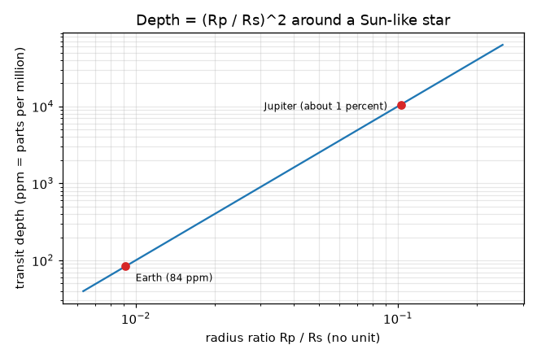
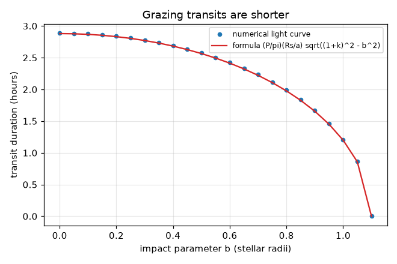
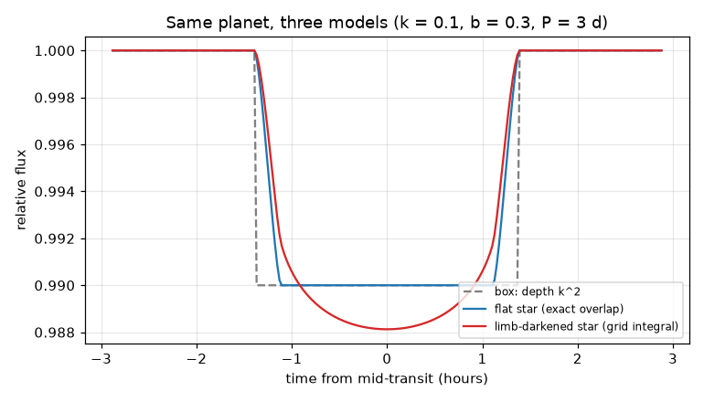
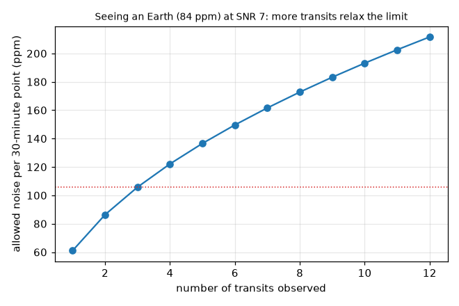

# Session 2: The mathematics of a transit

*Level 2 (mathematical engineering model) · about 75 minutes · openexoplanet*

> This is a simplified educational model. It is not a validated design tool and must not be used for real structures, electrical installations, vehicles, industrial processes or medical decisions.

**Prerequisites**

- Session 1: depth = (Rp/Rs)^2.
- Basic trigonometry (sine, cosine) and the idea of an integral as a sum over small pieces.
- Kepler's third law is explained in Section B; the repo openorbit teaches it in depth.

**Learning objectives.** After this session you can:

- Compute the depth for Jupiter and for Earth around the Sun and see why Earth is so hard to find.
- Compute a transit light curve by numerical integration, with and without limb darkening, and check it against exact geometry.
- Predict the transit duration from the period and the impact parameter, using Kepler's third law.
- Solve a design problem: how quiet must a telescope be to see an Earth?

## A. Real-world problem
Jupiter blocks about 1 percent of the Sun's light and is easy to detect. Earth blocks less than one hundredth of that. Real stars are also not flat disks: they are dimmer at the edge. And the telescope's measurements are noisy. How much noise can we tolerate if we want to see an Earth-size planet around a Sun-like star in three transits?

## B. Concept and theory
The depth is k^2 where k = Rp/Rs. Put the star (radius 1) at the origin and the planet (radius k) at a distance z from its centre. For a flat star the flux is 1 minus the overlapping area of the two circles divided by the star's area pi. A real star is brighter at the centre; with mu = cos(angle to the line of sight) = sqrt(1 - r^2) at radius r on the disk, the quadratic law I(mu)/I(1) = 1 - u1 (1 - mu) - u2 (1 - mu)^2 describes the dimming towards the edge, with illustrative coefficients u1 = 0.40 and u2 = 0.25. The flux is 1 minus the light under the planet divided by the star's total light, found here on a fine grid. For a circular orbit of period P around a star of mass M, Kepler's third law gives the orbit radius a. The planet's distance from the star's centre in the sky is z = sqrt((a/Rs)^2 sin^2 phi + b^2 cos^2 phi), where b = (a/Rs) cos i is the impact parameter, and the transit lasts while z < 1 + k, giving T ~ (P/pi)(Rs/a) sqrt((1+k)^2 - b^2). Transit n happens at t0 + nP, so a straight-line fit of mid-times against n gives P. With n_in measurements inside transits, each with noise sigma, the depth is measured to sigma / sqrt(n_in), so SNR = depth sqrt(n_in) / sigma.

| Symbol | Meaning | Unit |
|---|---|---|
| k = Rp/Rs | radius ratio | no unit |
| z | distance between planet and star centres, in star radii | no unit |
| u1, u2 | limb-darkening coefficients (0.40, 0.25 here) | no unit |
| mu | cos of the angle between line of sight and the surface normal | no unit |
| P | orbital period | days |
| a | orbit radius | m |
| G M | gravitational parameter of the star (1.327e20 for the Sun) | m^3 / s^2 |
| b | impact parameter: closest sky distance of the planet's path from the star's centre | star radii |
| i | orbit inclination (90 degrees = edge-on) | degrees |
| T | transit duration (first to last contact) | days or hours |
| sigma | noise per measurement | fraction of the star's flux (1e-6 = 1 ppm) |
| n_in | number of measurements inside transits | count |
| SNR | signal-to-noise ratio | no unit |

**Assumptions**

- Circular orbit, planet dark and much smaller than the star (k < 0.2).
- The star's disk is symmetric and follows the quadratic limb-darkening law with fixed coefficients.
- Duration formula assumes Rs much smaller than a.
- Noise is white (independent for each point) and the baseline outside transit is perfectly known (the SNR is an optimistic estimate).
- Teaching model: not a validated tool for planning a real observation.

$$ \delta=k^2=\left(\frac{R_p}{R_s}\right)^2 $$

$$ \frac{I(\mu)}{I(1)}=1-u_1(1-\mu)-u_2(1-\mu)^2,\qquad \mu=\sqrt{1-r^2} $$

$$ F=1-\frac{\iint_{\text{planet}} I\,dA}{\iint_{\text{star}} I\,dA},\qquad \iint_{\text{star}} I\,dA=\pi\left(1-\frac{u_1}{3}-\frac{u_2}{6}\right) $$

$$ a=\left(\frac{GMP^2}{4\pi^2}\right)^{1/3} $$

$$ b=\frac{a}{R_s}\cos i,\qquad T\approx\frac{P}{\pi}\frac{R_s}{a}\sqrt{(1+k)^2-b^2} $$

$$ \mathrm{SNR}=\frac{\delta\sqrt{n_{\rm in}}}{\sigma}\;\Rightarrow\;\sigma_{\max}=\frac{\delta\sqrt{n_{\rm in}}}{\mathrm{SNR}} $$

## C. Visual explanation
The first figure compares three models of the same transit (k = 0.1, b = 0.3, period 3 days): a grey box, the exact flat-star curve, and the limb-darkened curve, which is deeper (0.0121 against 0.0100 at mid-transit) and has rounded edges. The second figure is depth against radius ratio on log axes, with Jupiter near 1 percent and Earth at 84 ppm. The third shows the duration against the impact parameter b: the numerical points lie on the formula curve and the transit gets shorter as b grows toward 1. The fourth shows the noise per point you may have against the number of transits observed.

*Depth against radius ratio on log axes, with Jupiter and Earth marked.*

*Duration from the numerical light curve (dots) and from the formula (line) for different impact parameters.*

*One planet, three models: box, flat star (exact overlap) and limb-darkened star (grid integral).*

*Noise per 30-minute point allowed for SNR 7 against the number of transits observed.*

## D. Interactive simulation
Run the lesson (`python start.py 2`), then open the live app: [Session 2: a limb-darkened transit](https://krunalpanchal1995.github.io/openexoplanet/session-02/) (or `app.html` in this folder). Change the planet size, the impact parameter and the limb-darkening strength; compare the grey flat box with the blue numerical light curve, and read the duration from the readout.

**Challenge.** Find a planet whose flat-star depth is at least 0.5 percent but which transits for under 2 hours (period 3 days).

## E. Worked example and experiment
**Problem.** An Earth twin crosses the centre of the Sun (b = 0) once per 365.25 days. Find its depth, a/Rs, the transit duration, and the noise per 30-minute measurement needed to detect it at SNR 7 from 3 transits.

1. k = 6371 / 695700 = 0.009158 and depth = k^2 = 8.39e-5 = 83.9 ppm.
2. Kepler: a = (GM P^2 / 4 pi^2)^(1/3) = 1.496e11 m, which is 149.6 million km and a/Rs = 215.0.
3. T = (P/pi)(Rs/a) sqrt((1+k)^2) = (365.25/3.1416)(1/215.0)(1.00916) = 0.546 days = 13.10 hours.
4. A 30-minute cadence gives floor(13.10 / 0.5) = 26 measurements per transit, so n_in = 3 x 26 = 78.
5. sigma_max = depth x sqrt(n_in) / SNR = 83.9 ppm x sqrt(78) / 7 = 105.8 ppm per measurement.
6. Check by simulation: the mean of 78 points with 105.8 ppm noise scatters by 105.8/sqrt(78) = 12.0 ppm, and 83.9/12.15 = 6.9, close to 7.

**Answer.** Depth 83.9 ppm, a/Rs = 215.0, duration 13.10 hours, 26 points per transit; the noise must be below about 106 ppm per 30-minute point.

**Experiment.** Try it with real data: public light curves from space telescopes list their measured noise (in ppm per 30 minutes). Compare it with 106 ppm. Real stars add more noise than the white noise assumed here (spots, flares, instrument drifts), so a real Earth twin is harder than this model says: the model is a lower bound on the difficulty.

## F. Assessment and design challenge
**Question type A: Conceptual.** Why is the limb-darkened transit deeper in the middle than (Rp/Rs)^2, and why are its edges rounder?

Hint

Where on the star is the planet when it is in the middle, and how bright is that part compared with the average?

Step-by-step solution

At mid-transit (b = 0) the planet covers the centre, which is brighter than the star's average (the edge is dimmer), so it blocks more than its share of area: depth is about k^2 / (1 - u1/3 - u2/6) = 0.0121 for k = 0.1. At ingress and egress it covers the dim edge, which blocks less light, so the curve slopes gently.

**Question type B: Numerical.** A planet with a radius of 2 Earth radii orbits a star of 0.5 solar radii. Find the transit depth in ppm.

Hint

k = Rp / Rs with both radii in km.

Step-by-step solution

Rp = 2 x 6371 = 12742 km and Rs = 0.5 x 695700 = 347850 km, so k = 0.03663 and depth = k^2 = 1.342e-3 = 1342 ppm. Sanity check: smaller stars make the same planet look bigger; depth is much more than the 84 ppm of Earth around the Sun.

**Question type C: Graph and simulation interpretation.** In the duration-against-b graph (k = 0.1, P = 3 d), read the duration at b = 0 and at b = 0.8. Why is it shorter at b = 0.8?

Hint

Use T = (P/pi)(Rs/a) sqrt((1+k)^2 - b^2) with a/Rs = 8.75.

Step-by-step solution

At b = 0: 2.88 hours; at b = 0.8: 1.98 hours. A path that crosses the star away from the centre is a shorter chord, so the planet is in front of the disk for less time; at b = 1 + k = 1.1 the path just misses and the duration is zero.

**Question type D: Design and optimisation challenge.** Design: your telescope gives 200 ppm noise per 30-minute point. How many transits of an Earth twin around a Sun-like star do you need for SNR 7? Is that practical?

Hint

n_in = (SNR sigma / depth)^2, then divide by 26 points per transit and round up.

Step-by-step solution

n_in = (7 x 200 / 83.9)^2 = 279 points, which is 279 / 26 = 10.7, so 11 transits. One transit a year means 11 years of observation, which is not practical for a single mission, so instead survey many stars, use a quieter telescope, or look at smaller stars where the depth is larger (see question B). Trade-off: noise, number of transits, and star size.

Score yourself with [RUBRIC.md](../../RUBRIC.md). Print the [activity sheet](activity_sheet.md) to work on paper.

## Common misconceptions
| Common misconception | What is actually true |
|---|---|
| The transit depth is exactly (Rp/Rs)^2 for any real star. | That holds for a uniformly bright disk; a real star is brighter at the centre, so a central transit is deeper (0.0121 instead of 0.0100 here). |
| The transit lasts as long as the planet takes to cross the star at any impact parameter. | Only a central crossing is the longest; paths with higher b are shorter chords and last less time; b above 1 + k gives no transit. |
| Longer orbital period means a deeper dip. | Depth depends on k only; a longer period only makes the transit longer and rarer. |
| More measurements always help a lot. | SNR grows as sqrt(n_in): four times as many in-transit points halves the noise, not quarters it. |

## Glossary
- **limb darkening**: the dimming of a star's disk toward its edge
- **impact parameter**: how far from the star's centre the planet's path crosses, in star radii
- **inclination**: tilt of the orbit; 90 degrees means we see it edge-on
- **ppm**: parts per million: 1 ppm = 0.0001 percent
- **SNR**: signal divided by the noise on it
- **cadence**: time between measurements

## Finish
1. Do the three coding tasks in [exercises.md](exercises.md).
2. Run `python start.py 2` again after your changes. It ends with the checkpoint; when it prints `PASS`, you are done. (Checkpoint only: `python start.py check 2`.)

Next: [Session 3](../session-03/README.md)
