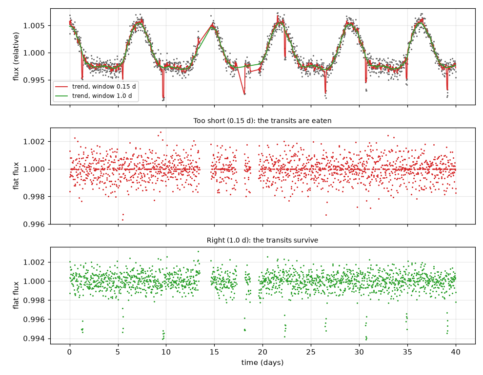
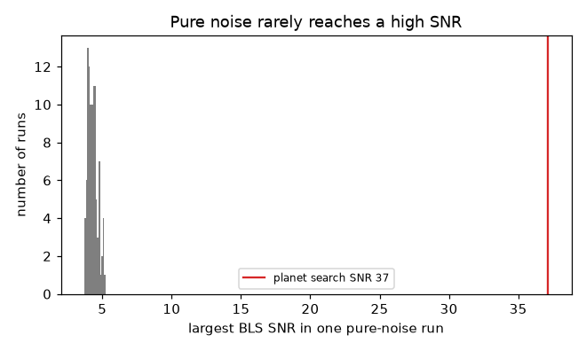
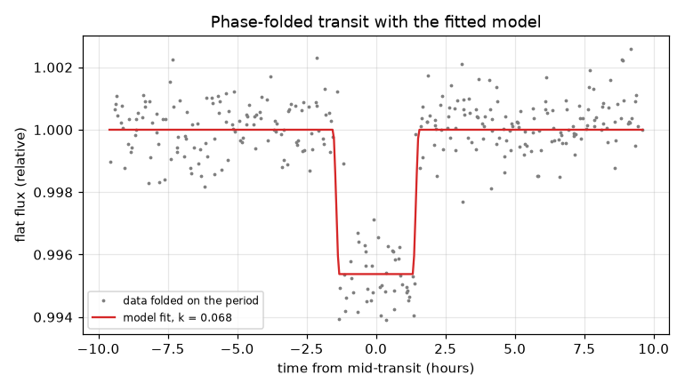
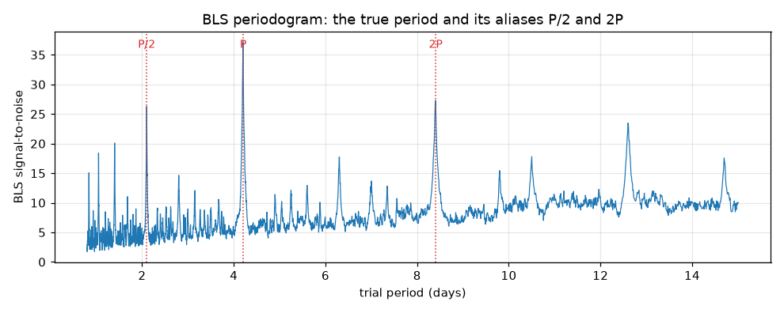

# Session 3: Find the planet in a noisy light curve

*Level 3 (simulation and validation) · about 90 minutes · openexoplanet*

> This is a simplified educational model. It is not a validated design tool and must not be used for real structures, electrical installations, vehicles, industrial processes or medical decisions.

**Prerequisites**

- Session 1: dips, depth and period.
- Session 2: transit model, duration and SNR.
- Mean, median and standard deviation of a list of numbers.

**Learning objectives.** After this session you can:

- Remove slow stellar variability with a moving median and show that a window that is too short erases the transits.
- Implement Box Least Squares (BLS) and recover an injected period, identifying the aliases at P/2 and 2P.
- Use the odd-even check to separate a planet from an eclipsing binary.
- Measure the false-alarm rate of the search on pure noise, and recognise two failure cases.

## A. Real-world problem
A real light curve is not a clean box: the star's own brightness drifts as spots rotate in and out of view, the noise can be larger than the dip in a single measurement, and the telescope sometimes stops looking. How do you find a regular dip of half a percent inside that? And once you find one, how do you know it is a planet and not a fluke of the noise or a second star eclipsing the first?

## B. Concept and theory
Step 1, detrend: divide the light curve by a moving median (the median of all points within a window). The slow variability survives in the median and is removed by the division. If the window is shorter than about three transit durations, the median follows the transit itself and the division erases it. Step 2, search: fold the data on a trial period; if the period is right the transits stack and a box-shaped dip appears. Box Least Squares scans trial periods, box durations and start phases, and for each box computes SNR = (mean outside - mean inside) / (sigma sqrt(1/n_in + 1/n_out)). The period with the largest SNR is the candidate. Folding at half the period leaves half the folded dips empty, and folding at twice the period shows each transit only once per fold, so both give a weaker peak at P/2 and 2P: aliases. Step 3, vet: an eclipsing binary has a deeper primary and shallower secondary eclipse; BLS may lock on half its orbit, so odd and even events have different depths. A planet gives equal depths. Step 4, false alarms: run the same search on pure noise many times, and record the largest SNR each time. The fraction of runs that beat a threshold is the false-alarm rate.

| Symbol | Meaning | Unit |
|---|---|---|
| t | time | days |
| f | relative flux (1 = normal) | no unit |
| window | width of the moving median | days |
| P | trial or true period | days |
| t0 | mid-transit time | days |
| n_in, n_out | number of points inside and outside the box | count |
| sigma | noise per point | fraction of flux |
| SNR | signal-to-noise ratio of the box | no unit |
| k | radius ratio | no unit |

**Assumptions**

- Synthetic data: uniform-disk transits, white noise and a sine-wave stellar variability, all seeded.
- BLS uses a flat box (a simplification of a real transit) and a single global sigma.
- The false-alarm numbers belong to the stated search (grid, durations, number of points) only.
- Teaching model, not a survey pipeline.

$$ f_{\rm flat}(t)=\frac{f(t)}{\mathrm{median}\{f(t'):|t'-t|<w/2\}} $$

$$ \mathrm{SNR}(P,t_0,d)=\frac{\bar f_{\rm out}-\bar f_{\rm in}}{\sigma\sqrt{1/n_{\rm in}+1/n_{\rm out}}} $$

$$ k\approx\sqrt{\delta},\qquad R_p=k\,R_s\;\left(\frac{695700}{6371}\ \text{Earth radii per solar radius}\right) $$

## C. Visual explanation
The first figure shows the raw light curve with a red trend from a 0.15 day window (which follows the dips) and a green one from a 1.0 day window; below them the flattened curves show the transits eaten by the short window and surviving in the long one. The second is the BLS periodogram: a tall peak at 4.2 days with lower peaks at half and twice that period. The third folds the data on the period and overlays the fitted model. The fourth is the histogram of the largest SNR found in pure noise: far to the left of the planet's SNR.

*Raw light curve with a too-short (red) and a good (green) moving median; the short window erases the transits.*

*Largest BLS SNR in 100 pure-noise runs, against the planet's SNR.*

*Transits stacked on the period with the fitted model.*

*BLS periodogram with the true period and its aliases at P/2 and 2P.*

## D. Interactive simulation
Run the lesson (`python start.py 3`), then open the live app: [Session 3: detrend, fold and search](https://krunalpanchal1995.github.io/openexoplanet/session-03/) (or `app.html` in this folder). Choose a window and look at the trend, then fold on a trial period and see the transits stack only at the right period. Switch to the periodogram and find the peak.

**Challenge.** Keep the transits (window of at least 0.5 days) and set the trial period to the true value, 4.2 days (within 0.05).

## E. Worked example and experiment
**Problem.** Use the mini-project light curve (star of assumed radius 0.9 solar radii, 50 days). Find the first planet and report its period, depth, radius ratio and radius in Earth radii, with the odd-even check.

1. Detrend with a 1.0 day moving median, then run BLS and refine: the strongest peak is at P = 6.431 days with SNR 25.
2. The box depth is 2311 ppm (0.002311).
3. Radius ratio: k = sqrt(0.002311) = 0.0481.
4. Radius: 0.0481 x 0.9 x 695700 / 6371 = 4.73, so about 4.7 Earth radii (the injected planet has 4.9).
5. Odd-even: the depths of odd and even transits differ by only 0.5 sigma, below 3 sigma, so the candidate passes.
6. Mask the transits and search again: the second planet appears at P = 2.710 days with SNR 9.5, radius 2.6 Earth radii, odd-even 1.7 sigma. Both are above the SNR threshold of 7.

**Answer.** Planet 1: P = 6.431 d, depth 2311 ppm, k = 0.048, about 4.7 Earth radii. Planet 2: P = 2.710 d, about 2.6 Earth radii. Both pass the odd-even check.

**Experiment.** Add one more column of reality: run the search with a different seed or a larger noise in `project_lightcurve` and see how SNR and radius change. In real surveys planets are confirmed with follow-up measurements and extra tests; a passing BLS and odd-even check only makes a candidate. The model underestimates the radius slightly because detrending and the box shape take a few percent of the depth.

## Real-world application and mini-project: Find the planets in a provided light curve
A telescope watched one star for 50 days at 30-minute cadence. The star has spots that dim it by a few tenths of a percent as it rotates, there are gaps in the data, and two planets are hiding in it. `project_lightcurve()` from Session 3 returns the data. Assume the star has radius 0.9 solar radii. Find both planets one after the other: detrend with a 1 day moving median, run BLS, refine, vet with the odd-even check, mask the transits you found, and search again.

**Deliverable:** A script that prints, for each planet found, the period (days), the depth (ppm), the radius ratio, the radius in Earth radii and the odd-even difference in sigma, and saves a phase-folded plot of each planet.

**Success looks like:** Two planets are found with periods 6.43 and 2.71 days (each within 1 percent), signal-to-noise above 7, radii of about 4.7 and 2.6 Earth radii (each within 10 percent of the injected 4.9 and 2.8), and both pass the odd-even check (below 3 sigma).

## F. Assessment and design challenge
**Question type A: Conceptual.** Why can BLS not tell the difference between period P and period 2P if every second transit falls in a data gap? What would you need to resolve it?

Hint

Which transits are actually in the data, and what does folding at P and at 2P do with them?

Step-by-step solution

If only the even transits are observed, folding at P and at 2P both stack the same set of transits and leave the same gaps, so the SNR is equal (28.2 and 28.1 in the lesson). Only data that include the missing transits (more observing time, or a second telescope) can show that there are also dips at the odd times.

**Question type B: Numerical.** A candidate has depth 0.0025 around a star of radius 0.9 solar radii. Find the planet radius in Earth radii.

Hint

k = sqrt(depth); then Rp = k Rs x 695700 / 6371.

Step-by-step solution

k = sqrt(0.0025) = 0.05; Rp = 0.05 x 0.9 x 695700 / 6371 = 4.91 Earth radii. Units: solar radii converted with 695700 km / 6371 km = 109.2 Earth radii per solar radius. Sanity check: between Neptune and Saturn sizes is plausible for a 0.25 percent dip.

**Question type C: Graph and simulation interpretation.** In the periodogram of the 4.2 day planet, which peaks are at about 2.1 and 8.4 days, and how do their heights compare with the main peak? Why are they lower?

Hint

Think about what folding at half and at double the period does to the transits.

Step-by-step solution

They are the aliases at P/2 and 2P, with SNR of about 26 and 27 compared with 37 for the true period (both below 0.8 of the main peak). At P/2 only half of the folded cycles contain a transit, so the stacked dip is diluted; at 2P each transit is seen once per fold and only half the data contribute to the dip, so its SNR is smaller by about sqrt(2).

**Question type D: Design and optimisation challenge.** Design: the transit lasts 0.12 days and the star's brightness varies with a period of 7.3 days. Choose a moving-median window and say what limits it on each side. Then say which SNR threshold you would adopt for a search like the one in the lesson and why.

Hint

Window at least 3 transit durations; not so long that the median cannot follow the variability. In 100 pure-noise runs, what was the largest SNR?

Step-by-step solution

The window must be at least 3 x 0.12 = 0.36 days or the median follows the transit (0.15 days keeps only 3 percent of the depth); it must be much shorter than 7.3 days or the median cannot follow the spots. 1.0 day keeps 94 percent of the depth. Pure noise gave at most SNR 5.2 in 100 runs and 7 percent of runs passed SNR 5, none passed SNR 6. A threshold of 7 is safe for this search (and is the value used by surveys), at the price of missing planets weaker than SNR 7. Trade-off: lower threshold finds more planets but more false alarms.

Score yourself with [RUBRIC.md](../../RUBRIC.md). Print the [activity sheet](activity_sheet.md) to work on paper.

## Common misconceptions
| Common misconception | What is actually true |
|---|---|
| A shorter smoothing window is always better because it follows the star more closely. | A window shorter than about three transit durations also follows the transit and erases it (3 percent of the depth survives for 0.15 days). |
| The highest peak in the periodogram is always the true period. | The aliases at P/2 and 2P are real peaks; with gaps, P and 2P can be nearly tied. |
| A strong BLS peak proves a planet. | An eclipsing binary can give a strong peak at half its orbit; the odd-even check and other tests are needed. |
| Noise can never produce a signal. | In 100 pure-noise runs, 7 percent had a largest SNR above 5, so a threshold has to be chosen above the noise's reach. |

## Glossary
- **detrending**: removing the star's slow brightness changes from a light curve
- **moving median**: replacing each point by the median of its neighbours inside a window
- **BLS**: Box Least Squares: a search for a repeating box-shaped dip
- **alias**: a false peak at a simple fraction or multiple of the true period
- **odd-even check**: comparing the depth of odd-numbered and even-numbered transits
- **false-alarm rate**: how often pure noise produces a signal above a chosen threshold
- **eclipsing binary**: two stars that pass in front of each other

## Finish
1. Do the three coding tasks in [exercises.md](exercises.md).
2. Run `python start.py 3` again after your changes. It ends with the checkpoint; when it prints `PASS`, you are done. (Checkpoint only: `python start.py check 3`.)

Next: the [roadmap](../../promo/roadmap.md). Session 4 is yours to build.
